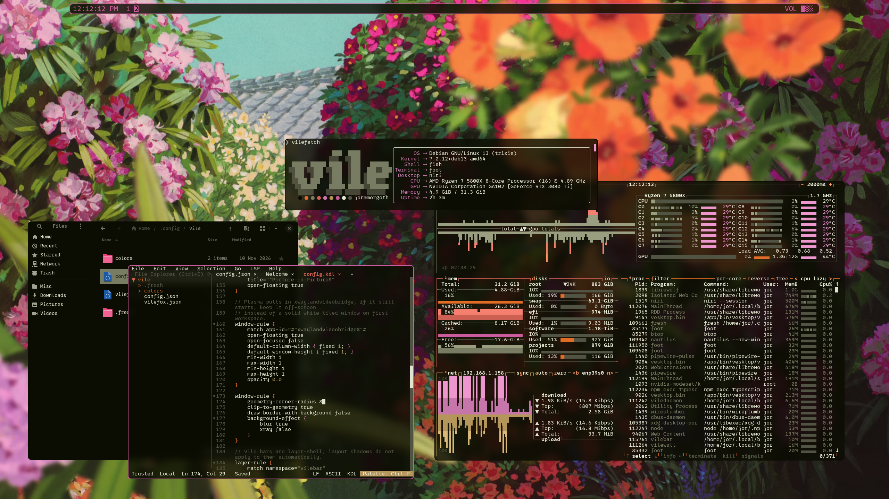
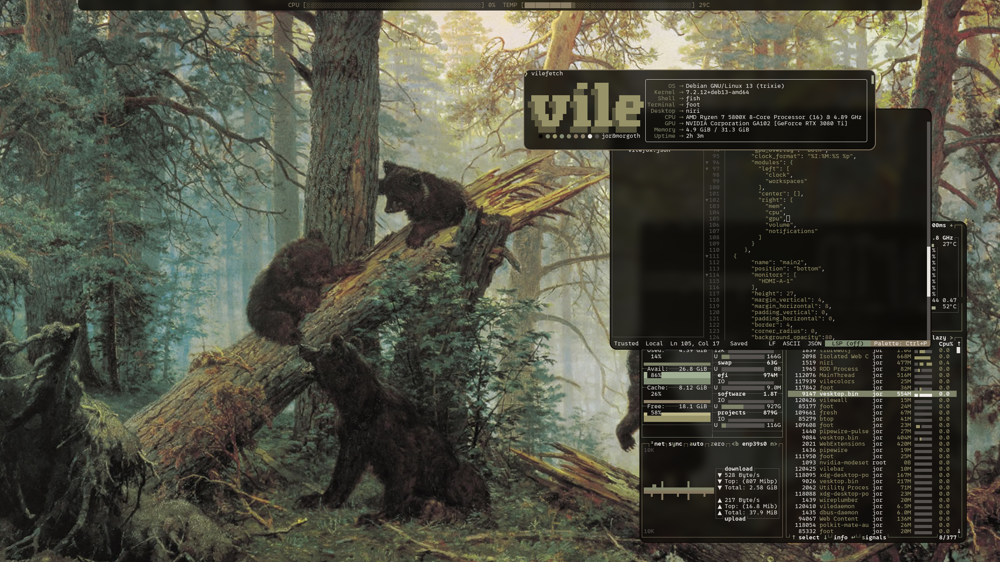
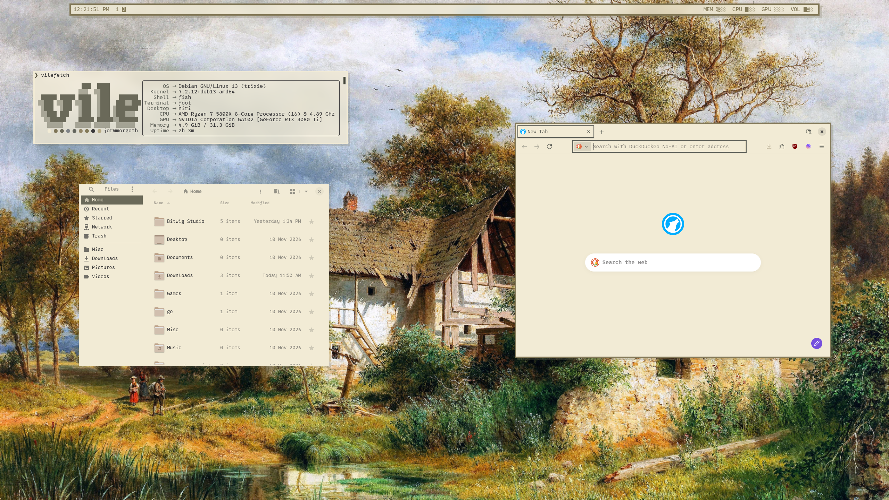
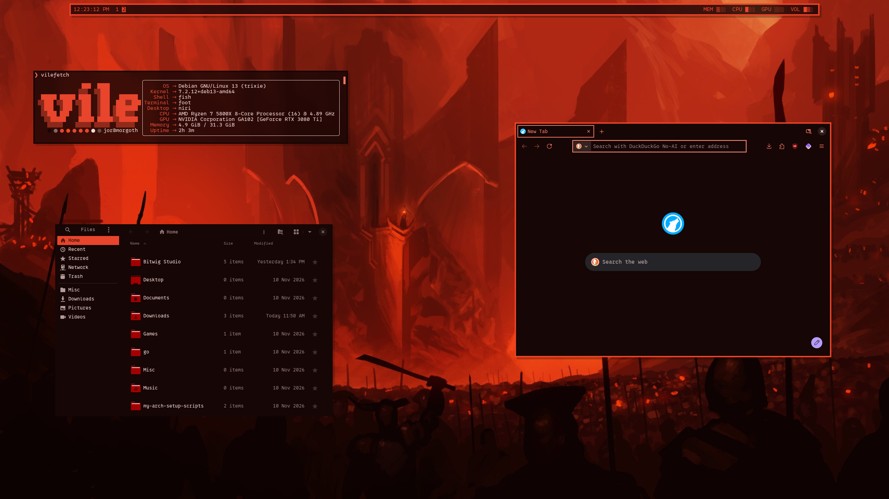
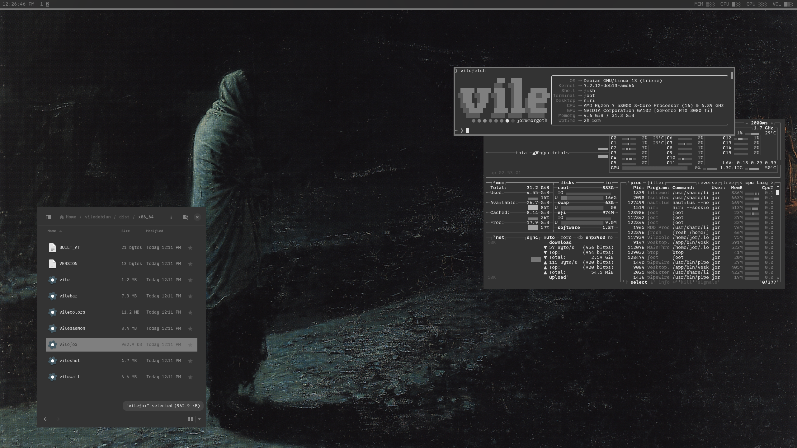
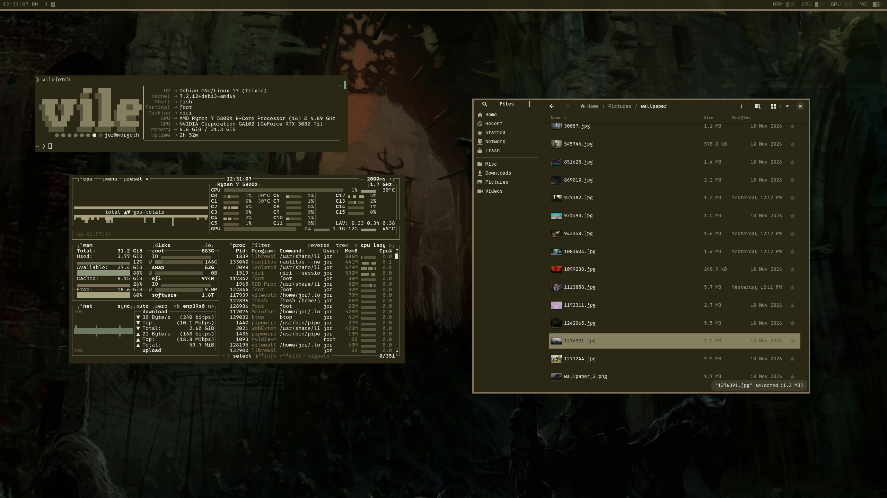

# Vile Debian

<div align="center">
<pre>
░░░░░░░░░░░░░░░░░░░░░░░░░░░░░░░░░░░░░░░░░░░░░
░░█░█░▀█▀░█░░░█▀▀░░░█▀▄░█▀▀░█▀▄░▀█▀░█▀█░█▀█░░
░░▀▄▀░░█░░█░░░█▀▀░░░█░█░█▀▀░█▀▄░░█░░█▀█░█░█░░
░░░▀░░▀▀▀░▀▀▀░▀▀▀░░░▀▀░░▀▀▀░▀▀░░▀▀▀░▀░▀░▀░▀░░
░░░░░░░░░░░░░░░░░░░░░░░░░░░░░░░░░░░░░░░░░░░░░
</pre>
</div>

<p align="center">
  <a href="screenshots/1.png" target="_blank" rel="noopener noreferrer"></a>
  <a href="screenshots/2.png" target="_blank" rel="noopener noreferrer"></a>
  <a href="screenshots/3.png" target="_blank" rel="noopener noreferrer"></a>
</p>
<p align="center">
  <a href="screenshots/4.png" target="_blank" rel="noopener noreferrer"></a>
  <a href="screenshots/5.png" target="_blank" rel="noopener noreferrer"></a>
  <a href="screenshots/6.png" target="_blank" rel="noopener noreferrer"></a>
</p>

Personal Debian Trixie dots and [viledesktop](viledesktop/), built around
[niri](https://github.com/YaLTeR/niri).

This is software I maintain for my own machines. You can use it if you want.
It is not a general-purpose desktop, and it is not written with support in mind.

## Overview

Two pieces that ship together:

1. **Dotfiles** — niri session config, terminal/shell setup (`foot` / `fish`),
   GTK theming, SDDM theme, and color templates that keep the session consistent.
2. **viledesktop** — a thin Wayland shell on top of niri: text bar, app search,
   power menu, notifications, tray, wallpaper, screenshots, and vilecolors /
   vilefox theming.

It does not try to replace a full desktop environment. No applet pile, no
heavily customized GUI apps. The point is to stay out of the way and keep you
in the terminal as much as possible. If that sounds annoying, this setup is
not for you — that is intentional.

Sources for the shell live under `viledesktop/`. Prebuilt binaries ship under
`dist/<arch>/` (refreshed with `viledesktop/pack-dist.sh`). The installer asks
whether to use those or compile from source.

## Stack

| Piece | Role |
| --- | --- |
| Debian 13 (Trixie) | Base system (+ backports kernel) |
| niri (Dux Labs) | Window manager / compositor |
| viledesktop | Bar, menus, notifications, tray, wallpaper, screenshots |
| vilecolors | Color scheme from wallpaper (terminal, GTK, niri, SDDM) |
| vilefox | LibreWolf / Firefox theme from the same palette |
| SDDM + vile | Display manager and login theme |
| foot + fish | Default terminal and shell |

## Requirements

- Fresh Debian 13 (Trixie) install
- Working network
- No existing DE or display manager required; the installer enables SDDM

## Installation

```bash
sudo apt update
sudo apt install -y git curl
git clone https://github.com/thatsvile/viledebian.git
chmod +x viledebian/vile/install.sh
bash viledebian/vile/install.sh
```

The script asks for sudo early and keeps it alive. make sure sudo is installed and configured.
It enables `trixie-backports` and installs a newer backports kernel, adds 
the Dux Labs repo for niri, installs LibreWolf via extrepo, and asks whether you
have an NVIDIA GPU. On YES it asks which driver source to use: Debian apt 
proprietary `nvidia-driver` (better for older GPUs such as Pascal / GTX 10xx) 
or NVIDIA's apt `nvidia-open` (latest; Turing+).
Both paths install 32-bit libs when possible and set the NVIDIA niri
session env. When it finishes, reboot.

This install script is meant to be run on a fresh Debian 13 Trixie installation 
that was done WITHOUT installing any Desktop Environments during the install process.
For best results, uncheck all desktop environments during debian installation before running this script.

What the installer roughly does: configures apt repos, installs packages, pulls a
few upstream tools/themes, installs viledesktop binaries (bundled `dist/` or a
local release build), copies configs and wallpapers, seeds a vilecolors palette,
sets up SDDM, installs the vilefox native host, and wires session autostart.

To refresh the committed binaries after changing `viledesktop/`:

```bash
chmod +x viledesktop/pack-dist.sh
./viledesktop/pack-dist.sh
```

## Essential keybinds

From `~/.config/niri/config.kdl` after install. Super is the Windows/Command key.

| Binding | Action |
| --- | --- |
| `Super` + `Tab` | Terminal (`foot`) |
| `Super` + `q` | Close focused window |
| `Alt` + `Space` | App launcher |
| `Super` + `Space` | Power menu |
| `Super` + `Shift` + `t` | System tray |
| `Super` + `n` | Notifications |
| `Super` + `Shift` + `b/m/c/g` | Battery / mem / cpu / gpu overlays |
| `Super` + `Shift` + `p/o` | Screenshot full / crop |
| `Alt` + arrows | Move focus |
| `Super` + `Left` / `Right` | Switch tags |
| `Alt` + `f` | Fullscreen |
| `Super` + `a` | Toggle floating |
| `Alt` + `Tab` | Overview |

The full bind list is in the niri config — edit it there.

Useful terminal popups bound in the same file: `pulsemixer`.

## After install

- Log in through SDDM (vile theme).
- Default terminal is `foot`; shell is `fish`.
- Wallpapers live in `~/Pictures/wallpaper/`. Applying colors through
  `vile --colors` refreshes terminal, GTK, niri, SDDM, and LibreWolf (vilefox).
  Post-apply shell commands live in `~/.config/vile/config.json` under
  `colors_apply_commands` (fallback) and optional
  `colors_apply_commands_dark` / `colors_apply_commands_light` selected from
  colorlab Theme base (niri reload + `vile-refresh.sh` with prefer-dark/light
  by default).
  SDDM sync goes through a polkit helper (`/usr/local/lib/vile/sddm-sync.sh`);
  the theme directory stays root-owned and is not user-writable.
- **niri:** `~/.config/niri/`
- **vile:** `~/.config/vile/` (`config.json`, recipes, templates, vilefox.json).
  Bars accept `background_opacity` (0–100; default 100) for a translucent fill
  only (text stays solid). For niri blur behind the bar, add a `layer-rule`
  matching `namespace="vilebar"` with `background-effect { blur true }`.
- **templates:** `~/.config/wal/templates/` (flat) and
  `~/.config/vile/colors/templates/`. With `"light_dark_mode": true` in
  `config.json`, Theme base also loads `templates/light/` or `templates/dark/`;
  same-name files in the base `templates/` dir override those, and base-only
  files apply to both themes. With the flag off (default), only base files are
  used.
- **Vesktop:** `vesktop-clienttheme.css` is written to `~/.cache/wal/` on colors
  apply (`{vesktop.h/s/l}` from palette `background` hue/sat, with Theme-base S/L
  bands so dark stays near-black and light stays bright), then copied into Flatpak QuickCSS
  (`~/.var/app/dev.vencord.Vesktop/config/vesktop/settings/quickCss.css`) via
  `colors_apply_commands` (Chromium blocks `file://` `@import`).

LibreWolf auto-installs the signed vilefox add-on via policies
(`normal_installed` from `/usr/local/share/vile/vilefox-signed.xpi`). Firefox
still needs the XPI opened once (`~/.local/share/vilefox/vilefox-signed.xpi`
after `vilefox install`). Disable pywalfox if it is still installed.

## Maintenance (`vile --update`)

Refresh viledesktop binaries in `~/.local/bin` without re-running the full
installer:

```bash
vile --update
```

Mode comes from `~/.config/vile/config.json` → `update_mode`:

- `"binaries"` (default) — fetch this repo’s latest `main` and install newer
  files from `dist/<arch>/` when the upstream `VERSION` differs from the
  installed stamp
- `"source"` — fetch the repo and `cargo build --release` from `viledesktop/`

Regular Debian packages still update with `apt` as usual.

## Layout of this repo

```
vile/
  install.sh              # primary install path
  thestuff/
    .config/              # shipped user configs (incl. vile + niri)
    .local/bin/           # helpers and session scripts
    vile/                 # SDDM theme (root-owned after install)
    usr/local/lib/vile/   # privileged helpers (sddm-sync, librewolf policy, …)
    wallpaper/            # starter wallpapers
    aptlist.txt           # Debian packages the installer pulls
viledesktop/              # sources + pack-dist.sh (target/ stays gitignored)
dist/<arch>/              # prebuilt release binaries for install.sh
```

## Notes

This repo tracks my machines. Expect breakage if you follow it blindly.
Issues and patches may sit unanswered for a long time, or forever.


**AI Disclosure**

AI has been used as part of the creation process for aspects of this project.
